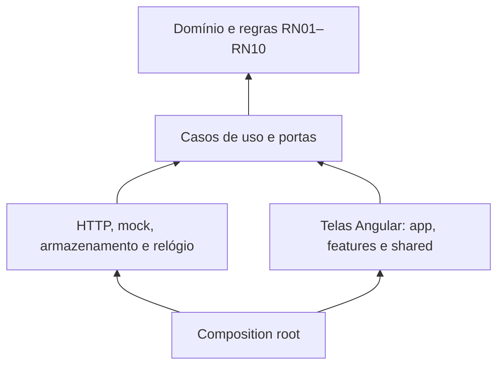

<div align="center">


# Arena Beach Tennis — Angular

Quadras, clientes, reservas e pagamentos de uma arena de beach tennis.

Angular 21 · TypeScript 5.9 · Angular Router · Angular Forms · Signals
</div>

## Começando

Requer Node.js **22.12+** (recomendado: 24 LTS) e npm.

```bash
npm ci
npm run dev
```

O servidor usa a porta **5173**. O backend simulado roda no navegador: não exige .NET, banco de dados nem credenciais externas.

| Perfil | E-mail | Senha de demonstração |
| --- | --- | --- |
| Cliente | isadora@email.com | 123456 |
| Administrador | admin@arena.com | admin123 |

Os botões **Acessar como** preenchem as contas. Em modo mock, **Cliente / Admin** troca o perfil no cabeçalho. As contas acima são exclusivamente dados públicos de demonstração.


## Funcionalidades

- Cadastro, login, sessão persistente, expiração e controle de acesso por perfil.
- Cliente: atualização dos próprios dados, consulta de disponibilidade, reservas com duração de 1h/1h30/2h, pagamento simulado por Pix/cartão/dinheiro, histórico e cancelamento com consequências financeiras.
- Administrador: dashboard por data e ocupação das quadras; grade diária com detalhes, alteração e cancelamento; cadastro/edição/status de quadras e clientes; busca, filtros e paginação; confirmação de recebimento e recibos.
- Regras RN01–RN10 preservadas na camada de domínio e revalidadas pelos casos de uso e pelo backend simulado.
- Estados de carregamento, erro e lista vazia; prevenção de envio duplicado; validação por campo; confirmação de ações destrutivas; proteção de alterações não salvas; interface em pt-BR e moeda BRL.
- Tema Ottawa Tech, fontes locais Sora/Figtree e layout responsivo.

O modo HTTP mantém o contrato REST ASP.NET Core. A disponibilidade da API real depende de um backend compatível; essa integração externa não foi testada.

## Comandos

| Comando | Uso |
| --- | --- |
| `npm run dev` | Angular CLI em desenvolvimento, porta 5173 |
| `npm run build` | Build Angular com compilação AOT e verificação estrita de templates |
| `npm run preview` | Servir o build de `dist/court-manager/browser` |
| `npm run typecheck` | Angular compiler (`ngc --noEmit`), incluindo templates |
| `npm run lint` | ESLint e fronteiras entre camadas |
| `npm run format` | Formatação com Prettier |

## Configuração

Todas as variáveis são opcionais. Para personalizar, copie `.env.example` para `.env`.

| Variável | Padrão | Uso |
| --- | --- | --- |
| `VITE_API_MODE` | `mock` | `mock` ou `http` |
| `VITE_API_BASE_URL` | `/api` | Base do cliente HTTP |
| `VITE_BACKEND_URL` | `http://localhost:5160` | Destino do proxy `/api` em desenvolvimento |

Os nomes `VITE_*` foram mantidos para compatibilidade com ambientes existentes. `scripts/ng.mjs` lê esses valores e os repassa ao builder Angular; não há runtime React. São valores públicos embutidos no frontend: nunca coloque segredos neles. O proxy preserva a validação TLS.

## Rotas

| Público | Cliente | Administrador |
| --- | --- | --- |
| `/login`, `/cadastro` | `/reservar`, `/minhas-reservas`, `/meus-dados` | `/admin/dashboard`, `/admin/reservas`, `/admin/quadras`, `/admin/clientes`, `/admin/pagamentos` |

O acesso sem sessão redireciona para login. O perfil incorreto retorna à própria home. Após login, a origem só é restaurada quando pertence ao perfil autenticado. Rotas desconhecidas exibem 404.

## Arquitetura



`src/main.ts` inicia `bootstrapApplication`. O token `APP_SERVICES` injeta a fachada dos casos de uso. As camadas de `src/core/` (domínio, aplicação e infraestrutura) permanecem independentes do Angular. As telas não importam axios nem repositórios.

A interface é organizada por domínio: o que é de uma tela fica junto. A tela de quadras, por exemplo, é `src/features/quadras/quadras.ts` (componente), `quadras.html` (template) e `quadras.css` (estilos só dela), ao lado da sua lógica (`quadras.utils.ts`), da validação (`quadras.schemas.ts`) e dos testes. Veja o [ADR-0010](docs/adr/0010-organizacao-das-pastas-por-dominio.md).

```text
src/
  app/                     casca: app.ts/.html/.css, rotas, estado global, guards e página 404
  features/                uma pasta por domínio, com tudo o que é das telas dele
    auth/                  login e cadastro
    reservas/              reservar/, minhas-reservas/ e grade/ (uma subpasta por tela)
    quadras/               quadras.ts, quadras.html, quadras.css, quadras.utils.ts, quadras.schemas.ts
    clientes/              clientes (administrador) e meus-dados
    pagamentos/            pagamentos e ajuda dos métodos de pagamento
    dashboard/             indicadores e ocupação
  shared/                  o que várias telas usam
    ui/                    diálogo, formulário, paginação e AsyncPage
    styles/                design tokens, global.css e fontes locais
    lib/                   datas, moeda, horários e máscaras
  core/                    núcleo sem Angular
    domain/                entidades, enums e regras RN01–RN10
    application/           DTOs, portas e casos de uso
    infrastructure/        HTTP, backend simulado, sessão e relógio
    di/                    montagem dos adaptadores
  config/                  configuração pública e contas demo
  main.ts                  bootstrap Angular
scripts/ng.mjs             configuração compatível com .env e proxy
angular.json               workspace Angular
```

## Verificação

```bash
npm run lint
npm run typecheck
npm run build
```

Os testes ficam só na cópia local, fora do repositório. Veja [testes](docs/testing.md) e [relatório de migração](docs/angular-migration.md).

## Documentação

- [Instalação, configuração e deploy](docs/getting-started.md)
- [Arquitetura](docs/architecture.md)
- [Telas e fluxos](docs/screens.md)
- [Regras de negócio](docs/business-rules.md)
- [Contrato REST](docs/api-contract.md)
- [Design system](docs/design-system.md), [DESIGN.md](DESIGN.md) e [contrato de UX](UX-CONTRACT.md)
- [Decisões técnicas](docs/adr/README.md)
- [Contribuição](CONTRIBUTING.md)

A migração Angular substitui a implementação React original; o histórico permanece disponível no Git. Os dados persistidos em `arena.mock-db.v1` e `arena.sessao` mantêm o mesmo formato.
