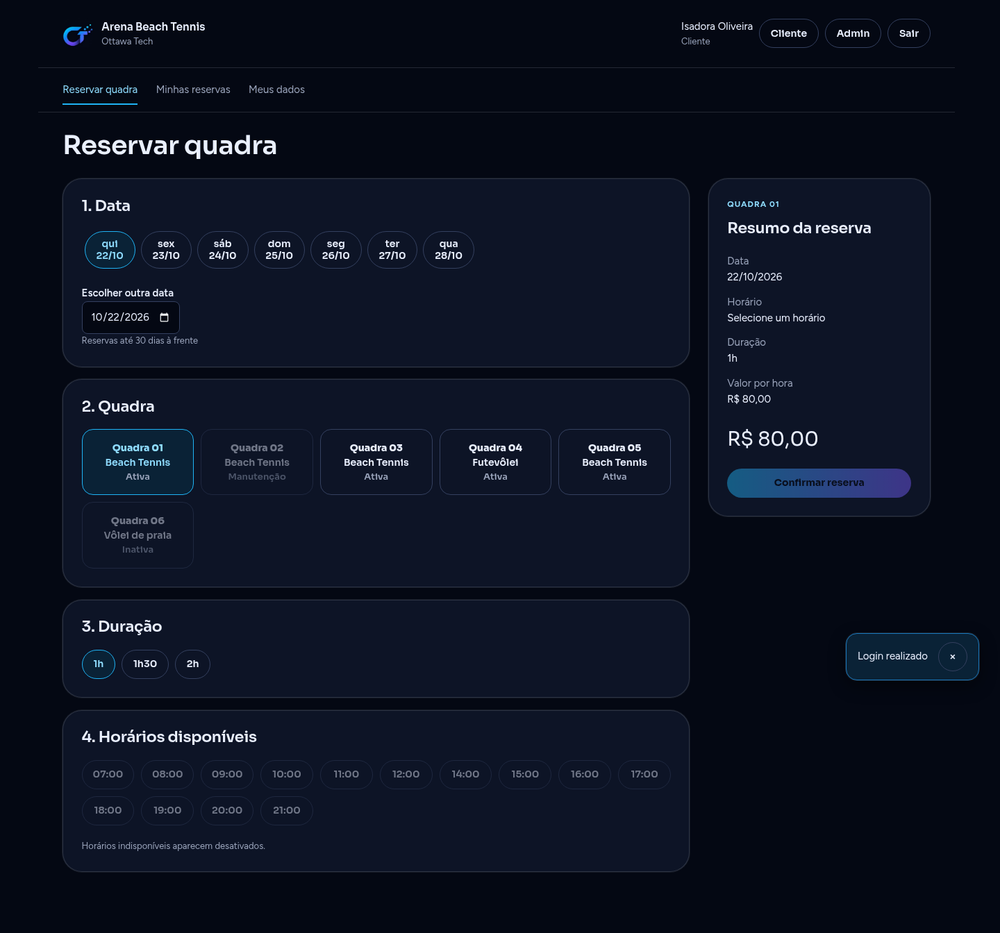
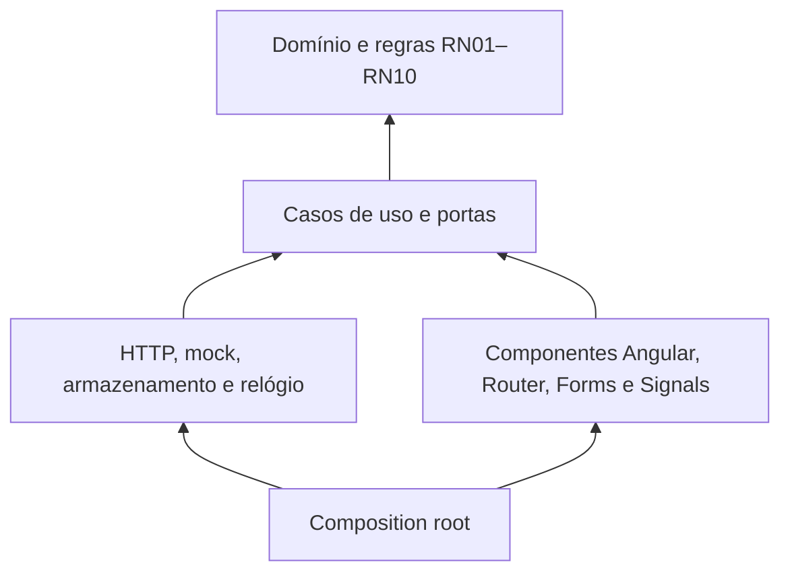

<div align="center">


# Arena Beach Tennis — Angular

Quadras, clientes, reservas e pagamentos de uma arena de beach tennis.

Angular 21 · TypeScript 5.9 · Angular Router · Angular Forms · Signals
</div>

## Começando

Requer Node.js **22.12+** (recomendado: 24 LTS) e npm.

```bash
npm ci
npm run dev
```

O servidor usa a porta **5173**. O backend simulado roda no navegador: não exige .NET, banco de dados nem credenciais externas.

| Perfil | E-mail | Senha de demonstração |
| --- | --- | --- |
| Cliente | isadora@email.com | 123456 |
| Administrador | admin@arena.com | admin123 |

Os botões **Acessar como** preenchem as contas. Em modo mock, **Cliente / Admin** troca o perfil no cabeçalho. As contas acima são exclusivamente dados públicos de demonstração.



## Funcionalidades

- Cadastro, login, sessão persistente, expiração e controle de acesso por perfil.
- Cliente: atualização dos próprios dados, consulta de disponibilidade, reservas com duração de 1h/1h30/2h, pagamento simulado por Pix/cartão/dinheiro, histórico e cancelamento com consequências financeiras.
- Administrador: dashboard por data e ocupação das quadras; grade diária com detalhes, alteração e cancelamento; cadastro/edição/status de quadras e clientes; busca, filtros e paginação; confirmação de recebimento e recibos.
- Regras RN01–RN10 preservadas na camada de domínio e revalidadas pelos casos de uso e pelo backend simulado.
- Estados de carregamento, erro e lista vazia; prevenção de envio duplicado; validação por campo; confirmação de ações destrutivas; proteção de alterações não salvas; interface em pt-BR e moeda BRL.
- Tema Ottawa Tech, fontes locais Sora/Figtree e layout responsivo.

O modo HTTP mantém o contrato REST ASP.NET Core. A disponibilidade da API real depende de um backend compatível; os testes do modo mock não comprovam essa integração externa.

## Comandos

| Comando | Uso |
| --- | --- |
| `npm run dev` | Angular CLI em desenvolvimento, porta 5173 |
| `npm run build` | Build Angular com compilação AOT e verificação estrita de templates |
| `npm run preview` | Servir o build de `dist/court-manager/browser` |
| `npm run typecheck` | Angular compiler (`ngc --noEmit`), incluindo templates |
| `npm run lint` | ESLint e fronteiras entre camadas |
| `npm test` | Regressão de lógica e componentes Angular (Vitest/TestBed) |
| `npm run test:watch` | Testes em observação |
| `npm run test:e2e` | Fluxos reais no Chromium (Playwright) |
| `npm run format` | Formatação com Prettier |

## Configuração

Todas as variáveis são opcionais. Para personalizar, copie `.env.example` para `.env`.

| Variável | Padrão | Uso |
| --- | --- | --- |
| `VITE_API_MODE` | `mock` | `mock` ou `http` |
| `VITE_API_BASE_URL` | `/api` | Base do cliente HTTP |
| `VITE_BACKEND_URL` | `http://localhost:5160` | Destino do proxy `/api` em desenvolvimento |

Os nomes `VITE_*` foram mantidos para compatibilidade com ambientes existentes. `scripts/ng.mjs` lê esses valores e os repassa ao builder Angular; não há runtime React. São valores públicos embutidos no frontend: nunca coloque segredos neles. O proxy preserva a validação TLS.

## Rotas

| Público | Cliente | Administrador |
| --- | --- | --- |
| `/login`, `/cadastro` | `/reservar`, `/minhas-reservas`, `/meus-dados` | `/admin/dashboard`, `/admin/reservas`, `/admin/quadras`, `/admin/clientes`, `/admin/pagamentos` |

O acesso sem sessão redireciona para login. O perfil incorreto retorna à própria home. Após login, a origem só é restaurada quando pertence ao perfil autenticado. Rotas desconhecidas exibem 404.

## Arquitetura



`src/main.ts` inicia `bootstrapApplication`. O token `APP_SERVICES` injeta a fachada dos casos de uso. As camadas de domínio, aplicação e infraestrutura permanecem independentes do Angular. A apresentação não importa axios nem repositórios.

```text
src/
  domain/                  entidades, enums e regras
  application/             DTOs, portas e casos de uso
  infrastructure/          HTTP, backend simulado, sessão e relógio
  di/                      montagem dos adaptadores
  config/                  configuração pública e contas demo
  presentation/angular/    componentes standalone, rotas, estado e UI compartilhada
  presentation/features/   lógica pura de exibição e testes de regressão
  presentation/validation/ esquemas Zod compartilhados
  presentation/styles/     design tokens e fontes locais
  shared/                  datas, moeda, horários e máscaras
  main.ts                  bootstrap Angular
scripts/ng.mjs             configuração compatível com .env e proxy
angular.json               workspace Angular
vite.config.ts             configuração exclusiva dos testes Vitest
```

## Verificação

```bash
npm run lint
npm run typecheck
npm test
npm run build
npm run test:e2e
```

O E2E usa `/usr/bin/chromium` no ambiente de nuvem. Em outra máquina, defina `CHROMIUM_PATH` com o caminho do Chromium/Chrome instalado. Veja [testes](docs/testing.md) e [relatório de migração](docs/angular-migration.md).

## Documentação

- [Instalação, configuração e deploy](docs/getting-started.md)
- [Arquitetura](docs/architecture.md)
- [Telas e fluxos](docs/screens.md)
- [Regras de negócio](docs/business-rules.md)
- [Contrato REST](docs/api-contract.md)
- [Design system](docs/design-system.md), [DESIGN.md](DESIGN.md) e [contrato de UX](UX-CONTRACT.md)
- [Decisões técnicas](docs/adr/README.md)
- [Contribuição](CONTRIBUTING.md)

A migração Angular substitui a implementação React original; o histórico permanece disponível no Git. Os dados persistidos em `arena.mock-db.v1` e `arena.sessao` mantêm o mesmo formato.
