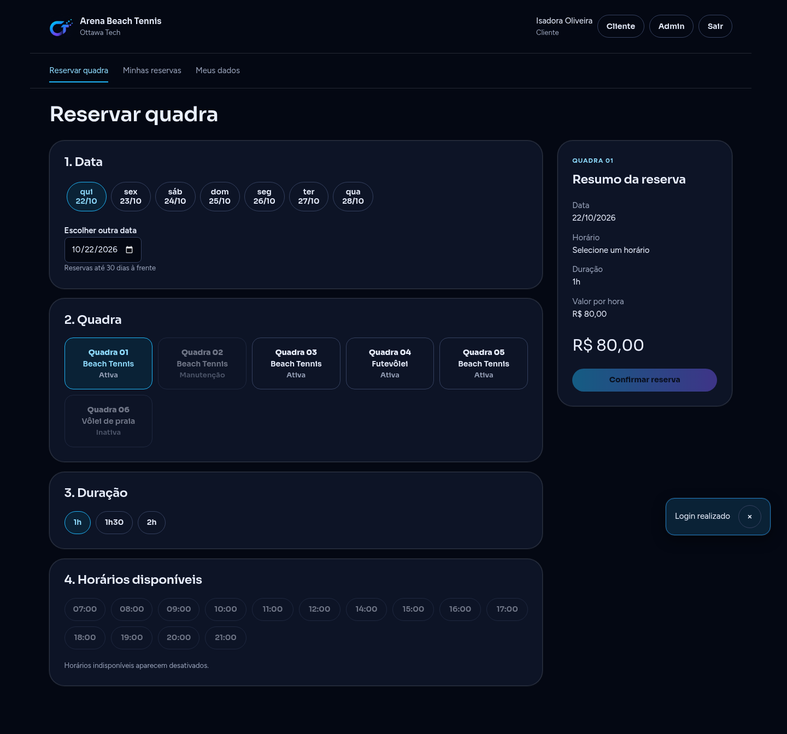
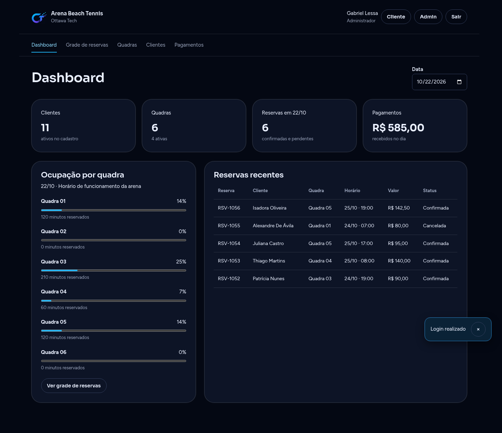
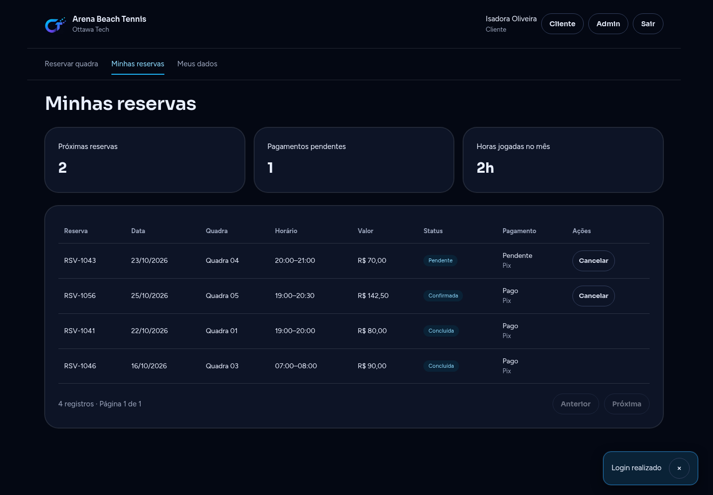
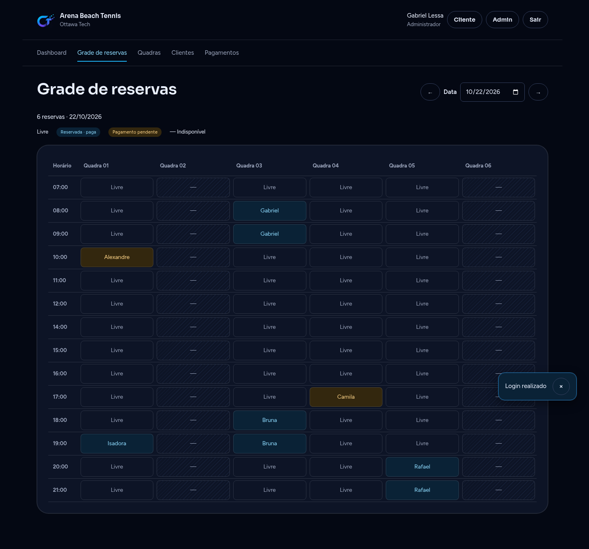
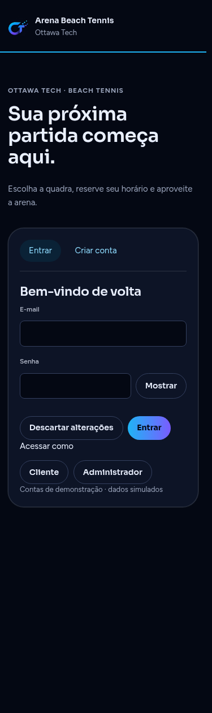
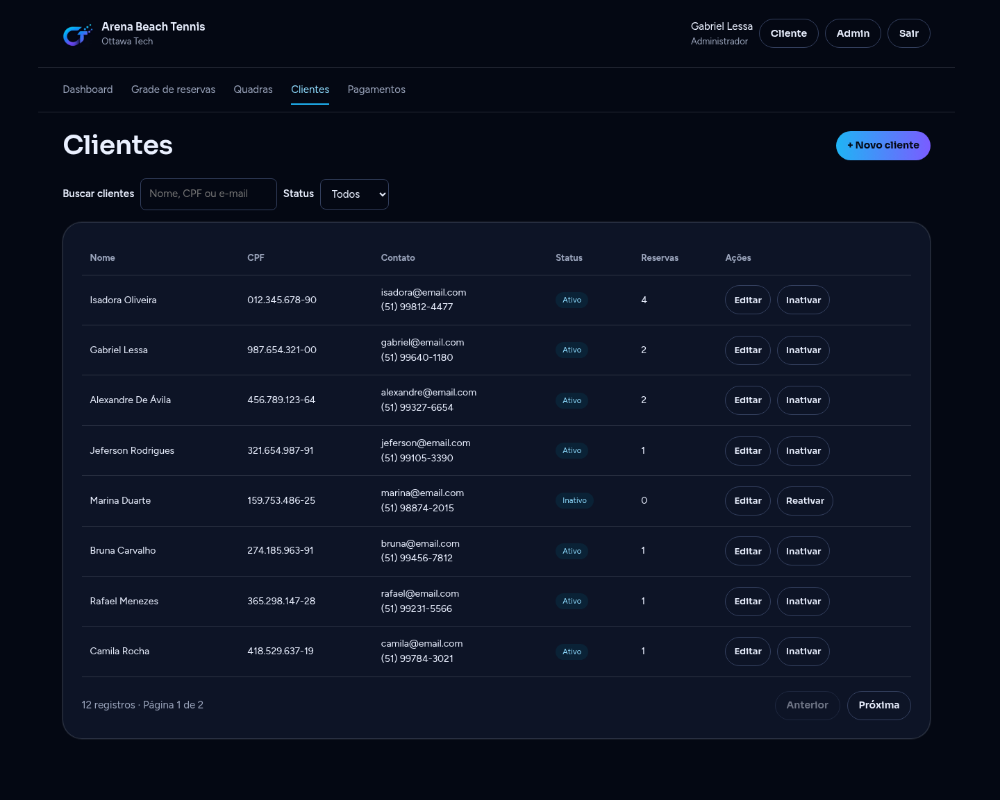

# Telas e fluxos

Todas as rotas são componentes Angular standalone em `src/presentation/angular/`. O tema e os fluxos permanecem compartilhados entre cliente e administrador. Capturas desta pasta anteriores à migração não são referência da implementação atual; veja o relatório de migração e a evidência E2E.

| Tela | Componente | Comportamento |
| --- | --- | --- |
| Entrar / Criar conta | `auth.component.ts` | Validação, contas demo no mock, cadastro com login, origem segura após autenticação |
| Reservar quadra | `booking.component.ts` | Data (faixa e campo), quadra, duração, slots com motivos, resumo e confirmação de pagamento |
| Minhas reservas | `reservations.component.ts` | Estatísticas, histórico ordenado, pagamento de reserva sem pagamento, cancelamento permitido e consequência financeira |
| Meus dados | `profile.component.ts` | Cadastro preenchido, senha opcional, reset, salvar e sincronizar sessão |
| Dashboard | `dashboard.component.ts` | Data, indicadores, ocupação e reservas recentes |
| Grade | `grade.component.ts` | Grade diária, legenda, detalhe, alteração com disponibilidade sem a própria reserva, cancelamento administrativo |
| Quadras | `courts.component.ts` | Criar, editar, preço por hora, tipo e status |
| Clientes | `clients.component.ts` | Criar, editar, buscar por nome/CPF/e-mail, filtrar, paginar, inativar/reativar com histórico |
| Pagamentos | `payments.component.ts` | Totais, filtros, paginação, confirmar dinheiro e consultar recibo |
| 404 | `not-found.component.ts` | Mensagem e retorno à home |

## Navegação e estados

Cabeçalho com identidade Ottawa Tech, sessão, sair e troca demo no mock. Menus seguem o perfil. Títulos por rota, link de pular para conteúdo e foco após navegação. Leituras têm carregamento, retry e vazio; formulários mantêm dados após erro e impedem duplicação. Diálogos têm nome, Escape, foco restaurado e confirmação antes de perder alterações. Busca e filtros de listas reiniciam a página.

## Roteiro de revisão

1. Entrar como cliente, escolher amanhã, quadra ativa, duração e horário livre; confirmar Pix.
2. Conferir o pagamento e cancelar a reserva futura; conferir estorno.
3. Fazer uma reserva em dinheiro; entrar como administrador, confirmar recebimento e consultar recibo.
4. Abrir a grade do dia, selecionar a reserva e alterar duração/horário/quadra; conferir os dados após salvar.
5. Cadastrar/editar quadra e cliente; testar status, pesquisa e paginação.
6. Atualizar perfil e conferir nome no cabeçalho; sair e entrar novamente.
7. Repetir o acesso e os formulários em 375px, navegar por teclado, abrir select e cancelar diálogos com Escape.

As verificações automatizadas ficam em `e2e/migration.spec.ts` e `src/presentation/angular/__tests__`. Regras detalhadas: [business-rules.md](business-rules.md). Contrato visual/comportamental: [DESIGN.md](../DESIGN.md) e [UX-CONTRACT.md](../UX-CONTRACT.md).

## Capturas da aplicação Angular

| Cliente | Administrador |
| --- | --- |
|  |  |
|  |  |
|  |  |
